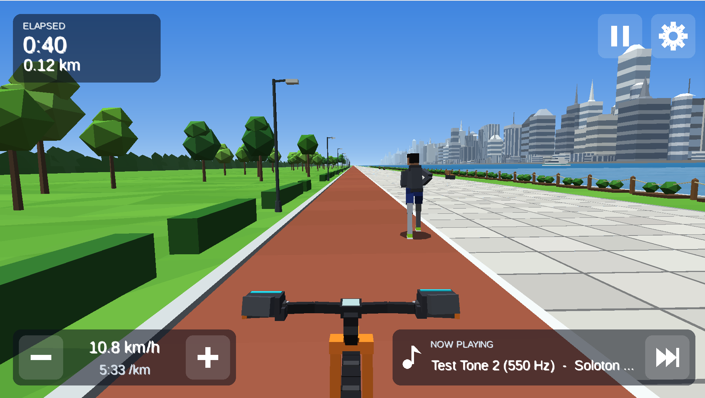

# Soloton

Homemade apps for a first-generation Peloton bike tablet (Android 7.0), sideloaded with tools such as [OpenPelo](https://github.com/doudar/Openpelo). GitHub Actions builds an installable APK for each app.

Not affiliated with or endorsed by Peloton. Sideloading is at your own risk.

## Status

The first app, `roadwork`, is complete and runs on an emulator shaped like the gen 1 tablet (Android 7.0, 1920x1080). Every push builds an APK and publishes it to the [`latest` release](../../releases/tag/latest). Progress, screenshots and downloads are on the [progress site](https://jasonsperske.github.io/soloton/). The owner reports that the bike's sensor data works on the real bike (2026-11-10); resistance is not tested there yet.

## Apps

| App | What it is | Status |
|---|---|---|
| `roadwork` | First-person bike ride through an [environment](docs/ENVIRONMENTS.md): a 3D scene paired with music you choose for it from the folders on the tablet, shuffled. It opens on a picker of environments. The first is a sunny city riverfront, pacing a jogger out on their roadwork. The second is a desert mesa where you follow a space runner and the bike's resistance lifts them off the trail: the harder it is set, the higher they fly and the busier the sky | Working on the gen 1 emulator; bike sensor data reported working on the owner's bike |

## Using it

- **Install on a bike:** download `roadwork.apk` from the [`latest` release](../../releases/tag/latest) and install it with `adb install -r`, or download and open it on the bike. See [docs/INSTALL.md](docs/INSTALL.md).
- **Build your own:** fork the repo; CI builds APKs with no setup. See [docs/CI_SETUP.md](docs/CI_SETUP.md) for signing so updates install over each other.
- **Build locally:** run `scripts/doctor.sh --fix` to check and install the JDK and Android SDK, then `./gradlew :apps:roadwork:android:assembleDebug`. See [docs/BUILDING.md](docs/BUILDING.md).
- **Music:** copy your own audio files to the tablet (default `/sdcard/Music/soloton`, one folder per game), then pick the folders and songs each environment plays in the app's music settings. No music is bundled or downloaded. See [docs/INSTALL.md](docs/INSTALL.md#copying-music-to-the-tablet).
- **Your music on the emulator:** name a local folder in a git-ignored `.env` and `scripts/gen1-emulator.sh` copies it over. See [docs/BUILDING.md](docs/BUILDING.md#your-own-music-env).

## Docs

- [docs/PLAN.md](docs/PLAN.md): architecture and work packages
- [docs/BUILDING.md](docs/BUILDING.md): prerequisites and build commands
- [docs/ADDING_AN_APP.md](docs/ADDING_AN_APP.md): adding an app to the monorepo
- [docs/CI_SETUP.md](docs/CI_SETUP.md): CI, signing, and releases
- [docs/INSTALL.md](docs/INSTALL.md): installing on the bike and copying music
- [docs/DEVICE.md](docs/DEVICE.md): the gen 1 tablet spec and its emulator
- [docs/BIKE_SENSORS.md](docs/BIKE_SENSORS.md) and [libs/bike/README.md](libs/bike/README.md): reading cadence, power and resistance from the bike, and how to verify it on a real one

## License

Copyright (C) 2026 Soloton contributors.

Soloton is free software under the [GNU General Public License, version 3](LICENSE) (`GPL-3.0-only`), the licence of the [PeloMon](https://github.com/ihaque/pelomon) repository, whose work decoding the Peloton Bike's sensor communications this project builds on. (PeloMon's firmware files carry their own CC-BY-NC 4.0 headers; Soloton uses PeloMon's published protocol facts and contains none of its code.) You may use, change and share it under those terms; anything you distribute that includes it must be released under the same licence, with source. It comes with no warranty.

Versions of this repository up to and including commit `0c23c35` were published under the MIT licence, and stay available under it.
